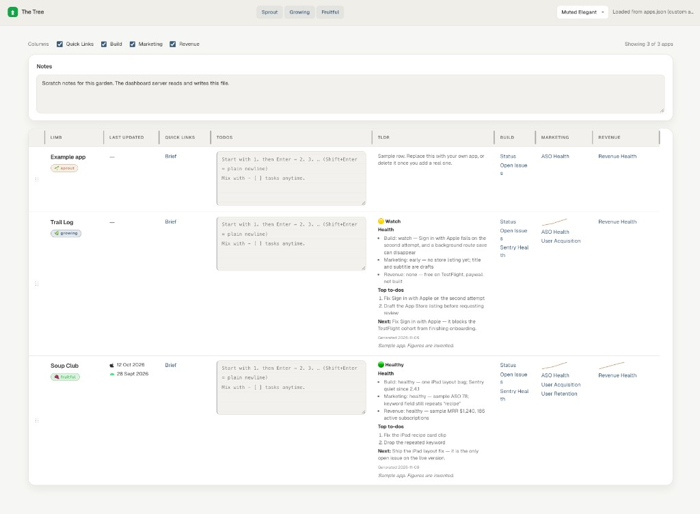

# The Trunk



## What it is

The PM index and shared skills for The Tree. This repo is the trunk: `apps.json`, the dashboard, and `.cursor/skills/`. App source does not live here.

Ideas sit in the sibling repo `the-sprouts`. Shipping apps sit in sibling `limb-*` repos. Sites sit in `the-saplings`.

Each app is one row: sprout, growing, or fruitful. The TLDR is the focus. Build, marketing, and revenue are the notes for that row.

```bash
node dashboard/server.mjs
```

Open http://localhost:4173. The picture above is that board with the sample rows. Trail Log and Soup Club use invented figures.

## Who's it for

Someone with more than one app, who wants one board for what each one needs next, and agent skills that already know this garden.

Take the skills into your own trunk. Leave your apps, sprout briefs, live metrics, and scratch notes (`dashboard/pm-dashboard-row-todos.json`) out of a public copy. See [contribute.md](contribute.md).

## Skills structure

Each skill is a folder with a `SKILL.md` under `.cursor/skills/`.

```text
.cursor/skills
├── trunk-skills                         
│   ├── gardener-ranking                
│   └── conversation-tldr-sync          
├── sprout-skills                        
│   ├── new-sprout
│   ├── sprout-prototype
│   ├── find-competition
│   ├── sprout-competition-analysis
│   ├── sprout-to-limb
│   └── cut-limb-or-sprout
├── build-skills                         
│   ├── code-to-user-stories
│   ├── upload-to-testflight
│   ├── sentry-healthcheck
│   └── guide-otp
├── marketing-skills                     
│   ├── marketing-interactive-workflow  
│   ├── calculate-market-size
│   ├── track-retention-and-acquisition-revenuecat
│   ├── aso-workflow                    
│   ├── reddit-workflow                 
│   ├── facebook-workflow               
│   ├── tiktok-workflow                 
│   ├── outreach-workflow               
│   └── product-hunt-workflow           
└── revenue-skills                      
    ├── revenue-health-revenuecat
    └── conversion-rate-revenuecat
```

Build skills are the set you copy into a limb when that app needs them. A limb keeps its own skills in that repo.

## How to use

Open this repo in Cursor. The agent reads `.cursor/skills/` and runs a skill when you ask for that job. Name the app. Say the skill name if you want that exact one. Sprout skills only run when you name them.

Start the board:

```bash
node dashboard/server.mjs
```

Open http://localhost:4173.

Ask in chat:

| You want | Ask |
|---|---|
| A new idea on the board | New sprout: a short name and what it is |
| A clickable mock | Prototype \<sprout\> |
| Who else does this | Find competition for \<sprout\> |
| A deeper look at those rivals | Run sprout-competition-analysis for \<sprout\> |
| Turn the idea into an app repo | Promote \<sprout\> to a limb |
| Drop an idea or an app | Cut \<sprout or limb\> |
| What to work on across everything | What should I work on next? |
| Refresh one row's TLDR | Update the TLDR for \<app\> |
| Which marketing job is next | Run marketing for \<app\> |
| The full App Store listing pass | Run the ASO workflow for \<app\> |
| One channel | Do Reddit for \<app\>. Same shape for Facebook, TikTok, outreach, or Product Hunt |
| How big the market is | Calculate market size for \<app\> |
| Subscription health | Revenue health for \<app\> |
| Trial and paywall conversion | Conversion rate for \<app\> |
| Retention and new customers | Track retention and acquisition for \<app\> |
| Crashes | Sentry healthcheck for \<app\> |
| A TestFlight upload | Upload \<app\> to TestFlight |
| What the code actually does | User stories from the \<app\> code |
| Email login on a new app | Set up email OTP for \<app\> |

One more shell command, outside chat. It creates `the-conversation/` in a limb repo:

```bash
node .cursor/skills/sprout-skills/sprout-to-limb/scaffold-the-conversation.mjs ../limb-<slug>
```

Copy a build skill into that limb's `.cursor/skills/` before you ask for TestFlight, Sentry, or OTP from the limb repo itself.
